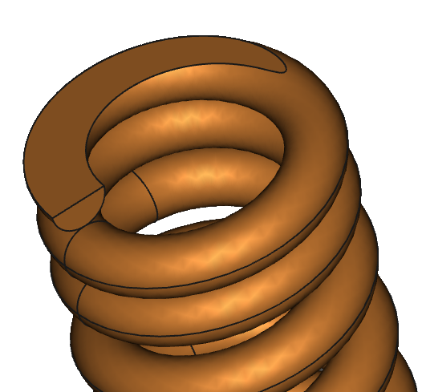

# SpringFull — compression spring macro for FreeCAD

[](https://www.gnu.org/licenses/old-licenses/lgpl-2.1.html)
[](https://www.freecad.org)
[](#version-history)

Design helical compression springs according to **EN 13906-1**, then generate them as parametric FreeCAD bodies.

**Author:** Yves Guillou · **Version:** 1.5.2 · **License:** LGPL v2.1



---

## Features

- **Calculation to EN 13906-1:** rate, loads, shear stress against the material's admissible stress, solid height, and a buckling-risk warning from the slenderness ratio (L0/Dm). The wire diameters the material cannot accept are shown in red and disabled.
- **3D geometry:** a detailed helix with closed and ground end coils, or a simplified tube for heavy assemblies.
- **Representation states:** free, loaded, solid or custom length. A length can be **taken from an edge** of your model.
- **Self-contained data:** every parameter is stored in properties of the spring's `PartDesign::Body`. Nothing depends on an external file.
- **Placement:** select a circular edge, an arc or a local coordinate system before launching, and the spring is created on it. This also works on a part linked into an assembly.
- **Editing:** select an existing spring, or any of its faces or edges, then launch to edit it, including a spring linked from another file.
- **One undo step:** a creation or modification is a single Ctrl+Z, calculator changes included. **Cancel** leaves nothing behind.
- **Assembly connectors:** the spring carries local coordinate systems at both ends.
- **Five interface languages:** English, French, German, Spanish and Italian.

> **Note:** SpringFull **saves** the documents it modifies when you confirm: the spring's own file first, then the assembly. It is the only macro of this family that does so.

---

## Requirements

- FreeCAD **1.0 or later** (developed and tested on 1.1), with the PartDesign workbench
- No external dependency

---

## Installation

1. Download or clone this repository.
2. Copy `SpringFull.FCMacro` and the `SpringFull/` folder into your FreeCAD macro directory. To find it, open the menu **Macro → Macros…**: the directory is shown there.

```
Macro/
├── SpringFull.FCMacro    ← entry point, the file you run
└── SpringFull/
    ├── SpringFull.FCMacro            ← main macro (started by the entry point)
    ├── SpringFull*Module.py          ← calculation, geometry, dialogs, i18n
    ├── locales/                      ← interface and material names, 5 languages
    ├── templates/default.json        ← default parameters of a new spring
    └── utils/                        ← materials, wire diameters, end types
```

3. Run **Macro → Macros… → SpringFull.FCMacro → Execute**, or add it to a toolbar.

---

## Usage

1. Optionally select where the spring goes (circular edge, arc or LCS), or an existing spring to edit.
2. Run the macro. If several springs exist, choose one or **create a new spring**.
3. **Calculator:** set the material, wire diameter, coil diameter, number of active coils and lengths. The results update as you type.
4. Choose the representation (free, loaded, solid, custom) and the display mode (detailed or simplified).
5. **OK** builds or updates the geometry.

---

## Language

The first time the macro runs, it asks for the language and remembers it in `SpringFull/lang.txt`. To change it later, edit that file and write `en`, `fr`, `de`, `es` or `it`, or write `ask` to show the choice again.

---

## Version history

**1.5.x** (2026)
- Linked assemblies: creating, editing and saving through `App::Link`. Partially loaded documents are completed before writing.
- Placement on a circular edge, arc or LCS of a linked part.
- One undo step per creation or modification. **Cancel** removes the empty body and its coordinate systems.
- Length taken from an edge.
- Interface in five languages, language remembered in `lang.txt`.
- Calculator: incompatible wire diameters shown in red and disabled. The window fits its content.

**1.4.3** (2025-04-25): flat ends of ground springs widened from 180° to 270°.

**1.4.2** (2025-02-05): a new spring builds its geometry even when no template value was changed.

**1.4.0 – 1.4.1:** spring parameters grouped in read-only properties, inner and outer diameters added, automatic language detection.

---

## License

Licensed under the **GNU Lesser General Public License v2.1**. See [LICENSE](LICENSE).

## Author

Yves Guillou
